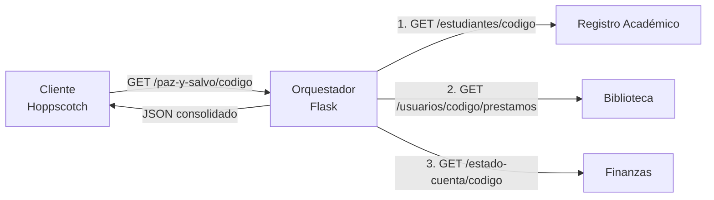

# Orquestador de Paz y Salvo para Grado

Proyecto final · Integración e Interoperabilidad de Soluciones Tecnológicas
**Línea de profundización:** Orquestación de servicios (orquestación directa)

El orquestador recibe la solicitud de paz y salvo de un estudiante, consulta en orden **Registro Académico → Biblioteca → Finanzas** y devuelve un JSON consolidado con el resultado: `APROBADO`, o `RECHAZADO` con los motivos.



## Estructura

| Carpeta | Servicio | Ruta principal | Puerto local |
|---|---|---|---|
| `orquestador/` | Orquestador | `/paz-y-salvo/<codigo>` | 5000 |
| `servicio_academico/` | Registro Académico | `/estudiantes/<codigo>` | 5001 |
| `servicio_biblioteca/` | Biblioteca | `/usuarios/<codigo>/prestamos` | 5002 |
| `servicio_finanzas/` | Finanzas | `/estado-cuenta/<codigo>` | 5003 |

Cada carpeta tiene su propio `app.py` y `requirements.txt` y se despliega como un servicio independiente. Los datos son ficticios y viven en memoria.

## Ejecución local

```bash
python -m venv .venv && source .venv/bin/activate
pip install -r orquestador/requirements.txt
python pruebas.py          # levanta los 4 servicios, ejecuta las pruebas y los apaga
```

Para levantarlos a mano, abra cuatro terminales:

```bash
cd servicio_academico  && python app.py     # :5001
cd servicio_biblioteca && python app.py     # :5002
cd servicio_finanzas   && python app.py     # :5003
cd orquestador && ACADEMICO_URL=http://127.0.0.1:5001 BIBLIOTECA_URL=http://127.0.0.1:5002 \
  FINANZAS_URL=http://127.0.0.1:5003 python app.py   # :5000
```

## Antes de comenzar (despliegue)

Verifique en Hoppscotch que cada microservicio responda JSON con el mismo código de prueba, por ejemplo:

- `https://URL-ACADEMICO.onrender.com/estudiantes/20211001`
- `https://URL-BIBLIOTECA.onrender.com/usuarios/20211001/prestamos`
- `https://URL-FINANZAS.onrender.com/estado-cuenta/20211001`

## GitHub

Suba este repositorio completo. Cada servicio es una carpeta independiente.

## Render

Cree **cuatro Web Services** conectados al mismo repositorio, cambiando solo el **Root Directory**:

| Web Service | Root Directory |
|---|---|
| academico | `servicio_academico` |
| biblioteca | `servicio_biblioteca` |
| finanzas | `servicio_finanzas` |
| orquestador | `orquestador` |

En todos:

- Build Command: `pip install -r requirements.txt`
- Start Command: `gunicorn app:app`

Variables de entorno **solo del orquestador**:

```
ACADEMICO_URL  = https://URL-REAL-ACADEMICO.onrender.com
BIBLIOTECA_URL = https://URL-REAL-BIBLIOTECA.onrender.com
FINANZAS_URL   = https://URL-REAL-FINANZAS.onrender.com
HTTP_TIMEOUT   = 20
```

Use la URL base sin barra final y sin la ruta del recurso.

## Hoppscotch

```
GET https://URL-ORQUESTADOR.onrender.com/
GET https://URL-ORQUESTADOR.onrender.com/paz-y-salvo/20211001
```

## Pruebas

| # | Caso | Petición | Respuesta esperada |
|---|---|---|---|
| 1 | **Exitosa**: estudiante al día | `/paz-y-salvo/20211001` | 200 · `APROBADO` |
| 2 | Deuda en Finanzas | `/paz-y-salvo/20211002` | 200 · `RECHAZADO` · saldo pendiente de $850.000 |
| 3 | Créditos incompletos | `/paz-y-salvo/20211003` | 200 · `RECHAZADO` · faltan 8 créditos |
| 4 | Préstamo y multa en Biblioteca | `/paz-y-salvo/20211004` | 200 · `RECHAZADO` · 2 motivos |
| 5 | **Inválido**: código mal formado | `/paz-y-salvo/abc` | 400 · el código debe tener 8 dígitos |
| 6 | **Inválido**: estudiante inexistente | `/paz-y-salvo/20999999` | 404 · `servicio: academico` |
| 7 | **Falla**: Biblioteca caída | detener Biblioteca y repetir el caso 1 | 502 · `servicio: biblioteca` · `NO_EMITIDO` |

En Render, el caso 7 se reproduce suspendiendo el servicio de Biblioteca (*Suspend Web Service*) o poniendo una URL errada en `BIBLIOTECA_URL`. Si un servicio no responde dentro de `HTTP_TIMEOUT` segundos, el orquestador devuelve **504**.

Salida de `python pruebas.py`:

```
[OK ] 1. Exitosa: estudiante al día
[OK ] 2. Rechazo: deuda en Finanzas
[OK ] 3. Rechazo: créditos incompletos
[OK ] 4. Rechazo: préstamo y multa en Biblioteca
[OK ] 5. Inválido: código mal formado
[OK ] 6. Inválido: estudiante inexistente
[OK ] 7. Falla: servicio Biblioteca caído
7/7 pruebas correctas
```

## Explicación

El orquestador recibe una petición, consulta **Académico**, luego **Biblioteca** y luego **Finanzas**, y devuelve un JSON consolidado. Es una **orquestación secuencial de lectura**: no modifica datos en ningún sistema.

- **Coordinación**: el orquestador define el orden de las llamadas y aplica la regla del proceso (créditos completos, sin préstamos ni multas, saldo en cero). Los servicios no se conocen entre sí.
- **Manejo de fallas**: la función `consultar` traduce cualquier problema (URL sin configurar, timeout, conexión rechazada, 404, error HTTP, respuesta que no es JSON) a una respuesta controlada que indica qué servicio falló. Si un paso falla, el proceso se detiene y **no se emite** paz y salvo con información incompleta.
- **Clave común**: los tres sistemas usan el mismo **código estudiantil**. Esto sí relaciona los registros, a diferencia de un ID interno que coincide por casualidad.

**¿Qué pasaría sin el orquestador?** El estudiante tendría que ir a cada dependencia, o cada sistema tendría que llamar a los otros dos (integración punto a punto). La regla del paz y salvo quedaría repartida, cada falla se manejaría de forma distinta y no habría un único punto que entregue un resultado consolidado.
