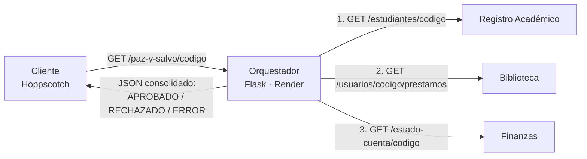

# Descripción del problema y solución propuesta

**Proyecto:** Orquestador de Paz y Salvo para Grado
**Línea de profundización:** Orquestación de servicios

## 1. Sistemas involucrados

| Sistema | Responsabilidad | Dato que aporta |
|---|---|---|
| Registro Académico | Historia académica del estudiante | Créditos aprobados y requeridos |
| Biblioteca | Préstamos de material | Préstamos activos y multas |
| Finanzas | Cartera estudiantil | Saldo pendiente y conceptos |

Los tres sistemas son simulados: son microservicios Flask independientes con datos ficticios. Comparten una clave común, el código estudiantil de 8 dígitos.

## 2. Problema

Para graduarse, un estudiante necesita un paz y salvo que confirme tres condiciones: que completó sus créditos, que no tiene deudas con la biblioteca y que no tiene saldos pendientes con la universidad. Cada condición vive en un sistema distinto que funciona de forma aislada. Hoy la verificación es manual: el estudiante o un funcionario consulta cada dependencia por separado. Esto genera demoras, respuestas inconsistentes y ningún registro único del resultado.

La dificultad de interoperabilidad es de **coordinación**. Ningún sistema tiene, por sí solo, la información para decidir, y la decisión requiere consultar los tres en un orden definido, combinar sus respuestas y reaccionar de manera uniforme cuando alguno no responde.

## 3. Solución propuesta y justificación del mecanismo

Se implementa un **orquestador** que expone un único endpoint, `GET /paz-y-salvo/<codigo>`. Al recibir la solicitud:

1. Valida el formato del código (400 si es inválido).
2. Consulta Registro Académico. Si el estudiante no existe, responde 404 y se detiene.
3. Consulta Biblioteca y luego Finanzas.
4. Aplica la regla del proceso y devuelve `APROBADO`, o `RECHAZADO` con la lista de motivos.
5. Si algún servicio falla (caído, timeout, error HTTP o respuesta no JSON), responde 502, 503 o 504 indicando qué servicio falló, y **no emite** el paz y salvo.

**¿Por qué orquestación?** El problema es un *proceso* de varios pasos sobre sistemas que no se conocen entre sí. La orquestación concentra en un solo componente el orden de las llamadas, la regla de negocio y el manejo de errores. Así los sistemas siguen desacoplados: ninguno necesita saber que los otros existen.

**¿Qué pasaría sin el mecanismo?** La alternativa es una integración punto a punto: el cliente o cada sistema llamaría a los otros directamente. La regla quedaría duplicada en varios lugares, cada falla se manejaría de forma distinta, y agregar un cuarto sistema (por ejemplo, Bienestar) obligaría a modificar varios servicios. Con el orquestador basta con agregar un paso.

## 4. Diagrama de arquitectura

Comunicación: HTTP/REST síncrono con JSON. Las URL de los servicios se configuran con variables de entorno (`ACADEMICO_URL`, `BIBLIOTECA_URL`, `FINANZAS_URL`) y el tiempo de espera con `HTTP_TIMEOUT`.

## 5. Verificación

- **Prueba exitosa:** el código `20211001` devuelve 200 con `APROBADO`.
- **Condición no válida:** `abc` devuelve 400 y `20999999` devuelve 404, indicando el servicio académico.
- **Falla:** con Biblioteca detenida, se devuelve 502 con `servicio: biblioteca` y `paz_y_salvo: NO_EMITIDO`.
